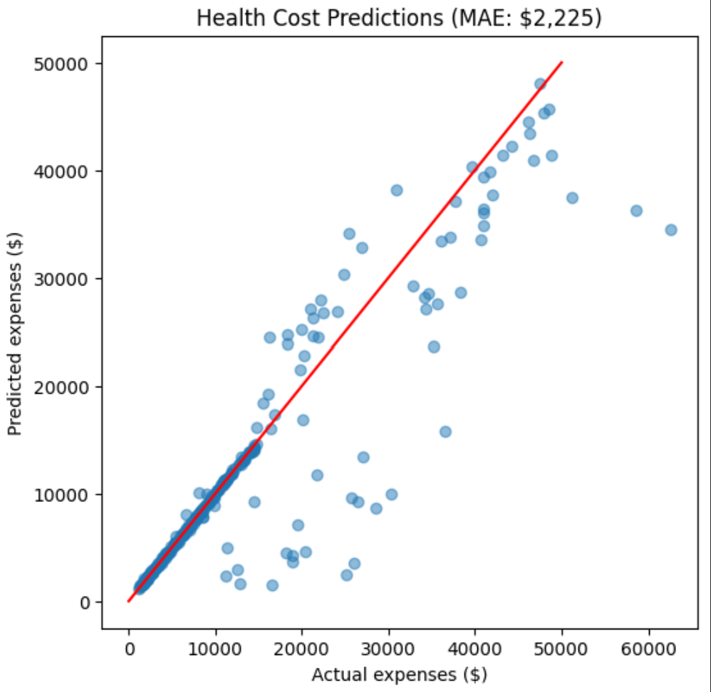

# freecodecamp-health-costs-predictor
# Health Costs Predictor

A neural network that predicts a person's yearly medical insurance costs from basic details like age, BMI, and smoking status.

**Result: predictions are off by $2,290 on average** (target was under $3,500).

## The problem
Insurance companies need to estimate how much a person will cost before they set a price. Using data on 1,338 people, this model learns which factors push medical costs up.

## What I did
1. **Explored the data**: 1,338 people, 6 features. Found that expenses are skewed, with a few people paying far more than the average.
2. **Turned text into numbers**: mapped `sex` and `smoker` to 0/1, and one-hot encoded `region` (since regions have no natural order).
3. **Split 80/20 into train and test**, keeping test data completely separate to avoid data leakage.
4. **Built a neural network** in TensorFlow/Keras: a normalization layer, two hidden layers of 64 neurons (ReLU), and one output neuron for the cost.
5. **Trained on Mean Absolute Error**, the same metric the project is graded on.

## Tools
Python, pandas, TensorFlow/Keras, Matplotlib, Google Colab

*Built as part of the freeCodeCamp Machine Learning with Python certification, written from scratch.*
